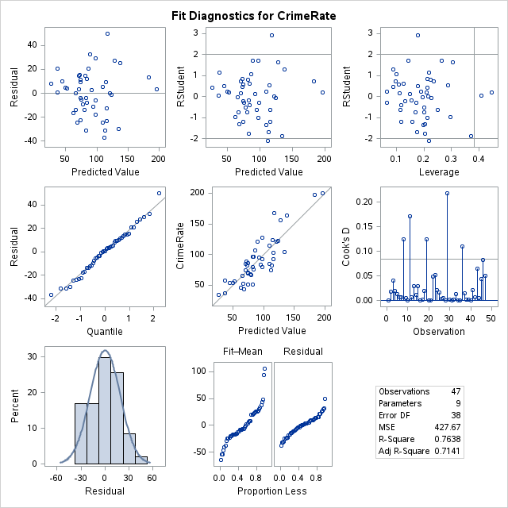
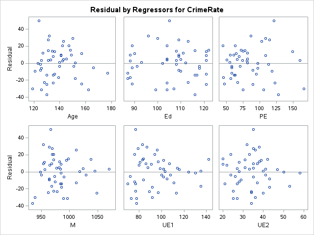
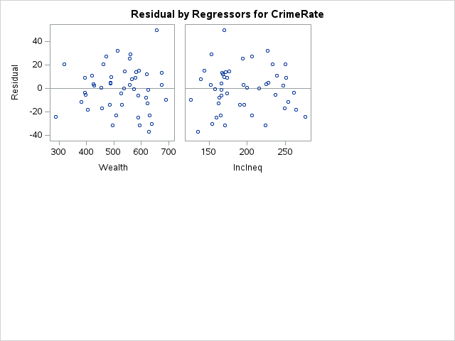

# Crime Rate Model Selection

Model selection for the crime rate using all possible regressions and stepwise
regression, with outlier, influence, and multicollinearity diagnostics.

**Course:** MATH 6364 Statistical Methods, Fall 2023, University of Texas Rio Grande Valley
**Author:** Areefin Ul Hassan Chowdhury
**Tools:** SAS (PROC REG, PROC GLMSELECT)

## Key Results

- **Stepwise final model** (lowest SBC, 304.21): **Age, Ed, PE, UE2, IncIneq** — adjusted R² **0.6967**, R² 0.7296, F = 22.13. About 70% of the variation in the crime rate is explained by these five predictors.
- **Best all-possible model** by adjusted R² (**0.7141**): Age, Ed, PE, M, UE1, UE2, Wealth, IncIneq (8 predictors).
- **Multicollinearity:** severe for PE (VIF 94.63) and PE1 (VIF 98.64) — near-duplicates of each other.
- **Outliers:** observation 2 (studentized residual 20.70), observation 11 (Cook's D 0.183), observation 29 (Cook's D 0.189).

## Figures

*Fit diagnostics for the best all-possible model (8 predictors; adjusted R² 0.7141): residuals vs predicted, studentized residuals vs predicted and vs leverage, Q–Q plot, observed vs predicted, Cook's distance by observation, and the residual distribution. Observation 2 stands out in the residual plots; observations 11 and 29 have the largest Cook's distances.*

*Residuals vs each regressor (Age, Ed, PE, M, UE1, UE2) for the best all-possible model — no strong patterns, consistent with a linear fit.*

*Residuals vs Wealth and IncIneq for the best all-possible model.*

## Data

The `crimerate` data: 47 observations (U.S. states) relating the crime rate to
13 demographic, economic, and law-enforcement predictors — Age, S, Ed, PE,
PE1, LF, M, Pop, NW, UE1, UE2, Wealth, and IncIneq.

Source: Vandaele, W., "Participation in illegitimate activities: Ehrlich
revisited", in *Deterrence and Incapacitation* (Blumstein, A., Cohen, J., and
Nagin, D., eds.), National Academy of Sciences, pp. 270–335, 1978.

The data are embedded in `code/model_selection.sas` as `datalines`, so the
program is self-contained and runs as-is in SAS.

## Methods

- **All possible regressions** (`PROC REG`, `selection=adjrsq`) — every
  subset of the 13 predictors, ranked by adjusted R-square.
- **Stepwise regression** (`PROC GLMSELECT`) — forward/backward selection by
  the Schwarz Bayesian Criterion (SBC), with entry and stay levels of 0.05.
- **Diagnostics** — studentized residuals, leverage, and Cook's distance for
  outliers and influential cases; variance inflation factors (VIF) for
  multicollinearity.

## Results

**Best all-possible model by adjusted R-square** (0.7141): Age, Ed, PE, M,
UE1, UE2, Wealth, IncIneq (8 predictors).

**Stepwise final model** (lowest SBC, 304.21): Age, Ed, PE, UE2, IncIneq

| Term | Estimate |
|---|---:|
| Intercept | −524.37 |
| Age | 1.02 |
| Ed | 2.03 |
| PE | 1.23 |
| UE2 | 0.91 |
| IncIneq | 0.63 |

R-square 0.7296, adjusted R-square 0.6967, F = 22.13 — about 70% of the
variation in the crime rate is explained by these five predictors. All five
coefficients are positive: higher values of each are associated with a higher
crime rate, holding the others constant.

**Full 13-predictor model:** R-square 0.7692, adjusted R-square 0.6783.
Significant predictors at the 0.05 level were Age (p = 0.019), Ed
(p = 0.009), UE2 (p = 0.044), and IncIneq (p = 0.002).

**Outliers and influential cases:** several observations stand out in the
diagnostics — observation 2 (studentized residual 20.70), observation 11
(Cook's D 0.183), observation 29 (Cook's D 0.189), and observation 8
(studentized residual 30.85).

**Multicollinearity:** severe for PE (VIF 94.63) and PE1 (VIF 98.64), which
are near-duplicates of each other; moderate-to-high for Wealth (9.97),
IncIneq (8.41), UE1 (5.94), and Ed (5.05). Coefficient estimates for the
highly collinear predictors should be interpreted with caution.

## How to Run

1. Open `code/model_selection.sas` in SAS Studio (or SAS OnDemand for Academics).
2. Run the whole program — no external files are needed: the 47-observation
   data set is embedded in the program as `datalines`.
3. The program runs the all-possible regressions, the stepwise selection, the
   outlier/influence diagnostics, and the VIF analysis, and produces the
   diagnostic plots shown above.

## Files

| File | Contents |
|---|---|
| `report/Crime_Rate_Model_Selection.pdf` | Full report (34 pp.): interpretation of the model-selection output, diagnostics, and coefficient discussion, with the SAS code and full SAS output appended |
| `code/model_selection.sas` | SAS program: data, all-possible regressions, stepwise selection, outlier/influence diagnostics, VIF, and full-model coefficients |
| `images/fit-diagnostics.png` | Fit-diagnostics panel for the best all-possible model |
| `images/residual-by-regressors-1.png` | Residuals vs Age, Ed, PE, M, UE1, UE2 |
| `images/residual-by-regressors-2.png` | Residuals vs Wealth and IncIneq |

## Notes

- The SAS program was transcribed from the SAS Studio code printout appended
  to the report; the data rows were checked line by line against the printout
  (47 observations, identical).
- The data set is named `sheep` in the original program — that name was kept
  unchanged for fidelity.

## License

MIT — see [LICENSE](LICENSE).
